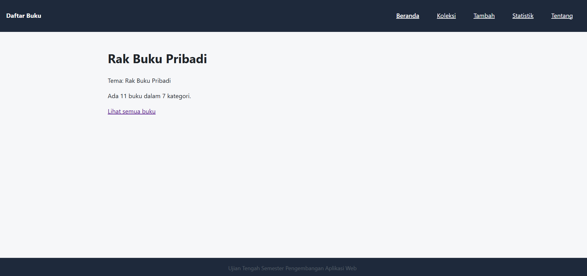
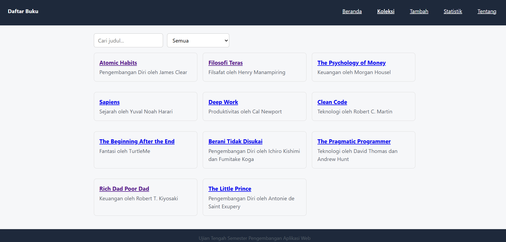
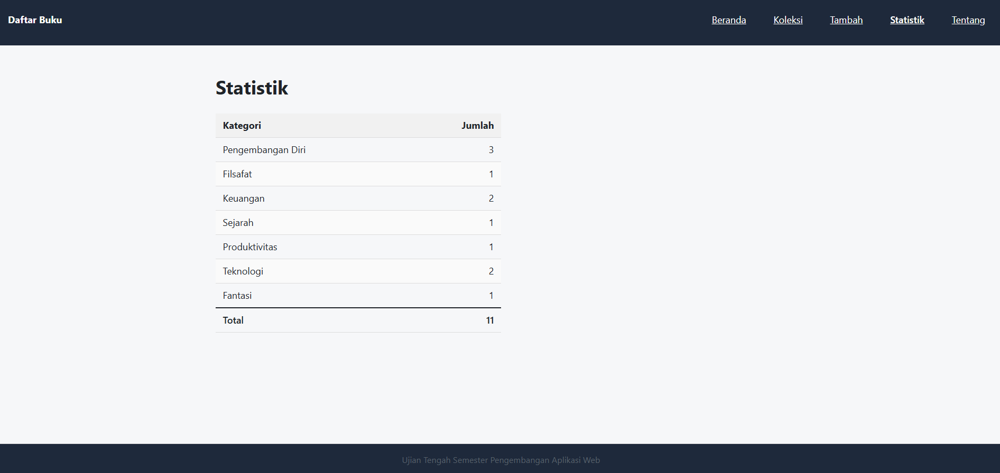
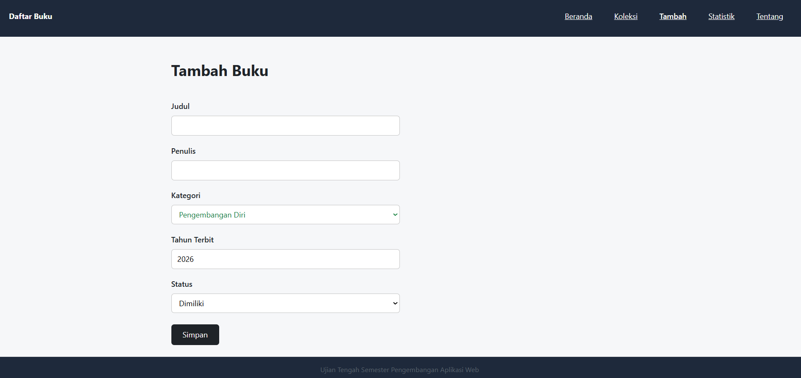
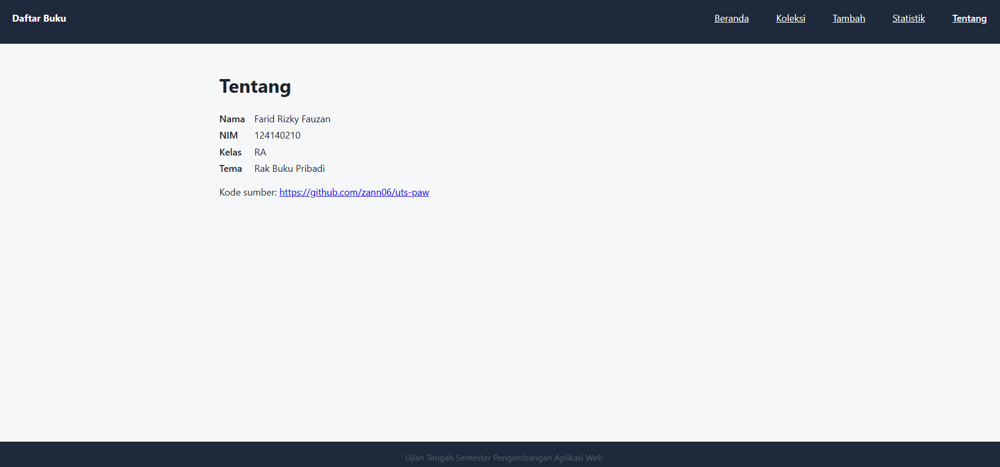

# Rak Buku Pribadi

**Nama:** Farid Rizky Fauzan  
**NIM:** 124140210  
**Kelas:** RA  
**Tema:** Rak Buku Pribadi  
**Deployment:** https://zann06.github.io/uts-paw/

## Tangkapan Layar Aplikasi

### Halaman Beranda


### Halaman Koleksi Buku


### Halaman Statistik


### Halaman Tambah


### Halaman Tentang


## Deskripsi Aplikasi

Rak Buku Pribadi merupakan aplikasi web sederhana untuk mengelola koleksi buku secara digital. Pengguna dapat melihat daftar buku, mencari berdasarkan judul, memfilter berdasarkan kategori, menambahkan buku baru, melihat detail buku, serta memantau statistik koleksi.

Aplikasi ini dibuat menggunakan React dan menyimpan data koleksi pada LocalStorage browser sehingga perubahan data tetap tersimpan meskipun halaman dimuat ulang.

## Fitur

1. **Beranda:** Menampilkan ringkasan jumlah buku dan jumlah kategori.
2. **Daftar Koleksi:** Menampilkan seluruh buku yang tersedia.
3. **Pencarian Buku:** Mencari buku berdasarkan judul.
4. **Filter Kategori:** Menyaring koleksi berdasarkan kategori buku.
5. **Tambah Buku:** Menambahkan buku dengan informasi judul, penulis, kategori, tahun terbit, dan status.
6. **Detail Buku:** Menampilkan informasi lengkap dari buku yang dipilih.
7. **Hapus Buku:** Menghapus buku dari koleksi dengan konfirmasi.
8. **Statistik:** Menampilkan jumlah koleksi berdasarkan kategori.
9. **Penyimpanan Lokal:** Menyimpan perubahan data menggunakan LocalStorage.

## Menjalankan Secara Lokal

Pastikan Node.js dan npm sudah terpasang.

1. Clone repository:

   ```bash
   git clone https://github.com/zann06/uts-paw.git
   ```

2. Masuk ke folder aplikasi:

   ```bash
   cd uts-paw/app
   ```

3. Instal dependencies:

   ```bash
   npm install
   ```

4. Jalankan aplikasi:

   ```bash
   npm run dev
   ```

5. Buka alamat lokal yang muncul di terminal, biasanya:

   ```text
   http://localhost:5173
   ```

## Konsep React yang Digunakan

- **Component:** Membagi tampilan aplikasi menjadi komponen seperti `KartuBuku`, `FilterKategori`, dan `KotakPencarian`.
- **Props:** Mengirimkan data dan fungsi antar-komponen.
- **useState:** Mengelola state pencarian, filter kategori, dan formulir tambah buku.
- **useEffect:** Menjalankan proses pemuatan data dan sinkronisasi LocalStorage.
- **Context API:** Mengelola data koleksi buku secara global menggunakan `KoleksiContext` dan `KoleksiProvider`.
- **Custom Hooks:** Menggunakan `useKoleksi` dan `useLocalStorage` untuk memisahkan logika pengelolaan data.
- **React Router:** Mengatur navigasi halaman menggunakan `Routes`, `Route`, `Link`, dan `useNavigate`.
- **Conditional Rendering:** Menampilkan kondisi loading, pesan kesalahan, dan kondisi ketika buku tidak ditemukan.
- **List Rendering:** Menampilkan daftar buku dan kategori menggunakan `map()`.
- **Event Handling:** Menangani interaksi pengguna seperti pencarian, pemilihan kategori, penambahan, dan penghapusan buku.

## Teknologi yang Digunakan

- React 19
- JavaScript
- Vite
- React Router DOM
- HTML dan CSS
- LocalStorage
- JSON

## Repository

GitHub: https://github.com/zann06/uts-paw

